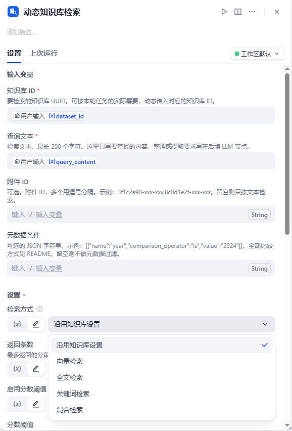
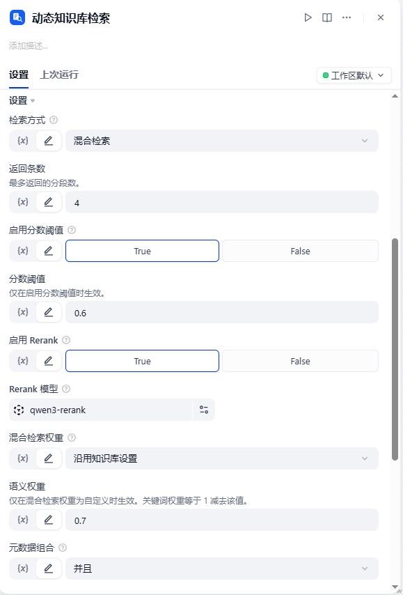

# 动态知识库检索

**作者:** xiaozie-xy  
**版本:** 0.0.1  
**类型:** 工具插件

## 概述

动态知识库检索是一个 Dify 工具插件。它按本次运行传入的知识库 ID 检索分段。

内置知识检索节点把知识库 ID 写在工作流配置里，同一次运行不能换成另一个库。本插件提供 `dataset_id` 参数。可按本轮任务的实际需要，动态传入对应的知识库 ID。

## 功能特性

- **运行时选择知识库**：每次运行检索哪一个库，由传入的 `dataset_id` 决定。
- **检索方式**：默认沿用该知识库自己的设置，也可以改成向量检索、全文检索、关键词检索或混合检索。
- **返回与过滤**：可设置返回条数、分数阈值。
- **Rerank**：可从当前工作区已配置的 Rerank 模型中选择。关闭时沿用知识库自己的设置。
- **混合检索权重**：可沿用知识库已保存的权重，或改为语义优先、关键词优先、自定义。嵌入模型名称取自该知识库。
- **元数据过滤**：可选。用 JSON 数组传入条件，每项包含字段名、比较方式和值。组合方式为并且（and）或或者（or）。留空则不过滤。
- **附件**：可选传入附件 ID，供多模态检索使用。
- **两个输出**：`result` 是分段列表，`context` 是拼好的文本。

## 安装方法

在 Dify 的插件页面上传 `dynamic_knowledge-0.0.1.difypkg`。自部署环境如果拒绝未签名的本地包，先在部署配置中关闭插件签名强制校验，再重新安装。装好后填写知识库服务 API 地址，以及范围覆盖全部知识库的 API Key。

## 配置说明

### 提供者凭证

插件只需授权一次。这把密钥和应用 API Key 不是同一把。

| 参数 | 说明 | 必填 |
|------|------|:----:|
| `api_base` | 知识库服务 API 地址，需包含 `/v1`。云端填 `https://api.dify.ai/v1`。自部署 Docker Compose 中，插件进程通常填 `http://api:5001/v1`。 | 是 |
| `dataset_api_key` | 在知识库 → 服务 API 中创建。运行时要检索不同知识库时，范围选「全部知识库」。限定到单个库的密钥只能访问该库。 | 是 |

### 工具参数

**变量绑定**

| 参数 | 中文名 | 说明 | 必填 |
|------|--------|------|:----:|
| `dataset_id` | 知识库 ID | 要检索的知识库 UUID。可按本轮任务的实际需要，动态传入对应的知识库 ID。 | 是 |
| `query` | 查询文本 | 检索文本，最长 250 个字符。这里只写要查找的内容，整理或提取要求写在后续 LLM 节点。 | 是 |
| `attachment_ids` | 附件 ID | 本次检索要带上的附件 ID，多个用逗号分隔。示例：`3f1c2a90-xxx-xxx,8c0d1e2f-xxx-xxx`。留空则只按文本检索。 | 否 |
| `metadata_conditions` | 元数据条件 | 元数据条件的 JSON 字符串。示例：`[{"name":"year","comparison_operator":"is","value":"2024"}]`。比较方式见下文。留空则不做元数据过滤。 | 否 |

**节点上配置**

| 参数 | 中文名 | 说明 | 默认 |
|------|--------|------|------|
| `search_method` | 检索方式 | 沿用知识库设置，或改为向量、全文、关键词、混合检索。 | 沿用知识库设置 |
| `top_k` | 返回条数 | 最多返回的分段数，范围 1 到 50。 | 4 |
| `score_threshold_enabled` | 启用分数阈值 | 关闭时沿用知识库自己的分数阈值。打开后使用下面的阈值。 | 关闭 |
| `score_threshold` | 分数阈值 | 分数阈值，范围 0 到 1。仅在启用分数阈值时生效。 | 无 |
| `reranking_enable` | 启用 Rerank | 关闭时沿用知识库自己的 Rerank 设置。打开后使用所选模型。 | 关闭 |
| `reranking_model` | Rerank 模型 | 从当前工作区已配置的 Rerank 模型中选择。 | 无 |
| `hybrid_weight_type` | 混合检索权重 | 沿用、语义优先、关键词优先、自定义。 | 沿用知识库设置 |
| `vector_weight` | 语义权重 | 自定义时的语义权重，范围 0 到 1。关键词权重等于 1 减去该值。 | 0.7 |
| `metadata_logical_operator` | 元数据组合 | 多条条件的组合方式：并且（and）或或者（or）。 | 并且 |

## 界面示例

输入变量可以绑定本轮运行的知识库 ID 和查询文本。附件 ID、元数据条件留空则不使用。检索方式默认沿用知识库设置。



返回条数、分数阈值、Rerank 模型和混合检索权重在节点的检索设置里配置。



## 使用示例

只按本轮任务检索一个知识库：

```text
dataset_id: 550e8400-e29b-41d4-a716-446655440000
query: 检索词
search_method: follow_dataset
top_k: 4
```

带上两个附件：

```text
attachment_ids: 3f1c2a90-xxx-xxx,8c0d1e2f-xxx-xxx
```

混合检索、自定义权重，并同时满足两条元数据：

```text
search_method: hybrid_search
hybrid_weight_type: customized
vector_weight: 0.6
metadata_logical_operator: and
metadata_conditions: [{"name":"category","comparison_operator":"is","value":"report"},{"name":"year","comparison_operator":"is","value":"2024"}]
```

语义优先时语义权重为 0.7、关键词权重为 0.3。关键词优先时反过来。未开启 Rerank 时，插件使用权重重排序。

### 元数据比较方式

字段含义以官方文档为准：[检索请求中的元数据过滤条件](https://docs.dify.ai/zh/api-reference/knowledge-bases/retrieve-chunks-from-a-knowledge-base-test-retrieval#body-retrieval-model-metadata-filtering-conditions-one-of-0)。

`comparison_operator` 只能取下表中的值。

| 比较方式 | 含义 | 示例 |
|----------|------|------|
| `contains` | 包含 | `{"name":"title","comparison_operator":"contains","value":"年报"}` |
| `not contains` | 不包含 | `{"name":"title","comparison_operator":"not contains","value":"草稿"}` |
| `start with` | 以指定内容开头 | `{"name":"code","comparison_operator":"start with","value":"A"}` |
| `end with` | 以指定内容结尾 | `{"name":"filename","comparison_operator":"end with","value":".pdf"}` |
| `is` | 等于 | `{"name":"year","comparison_operator":"is","value":"2024"}` |
| `is not` | 不等于 | `{"name":"status","comparison_operator":"is not","value":"draft"}` |
| `empty` | 为空，可不填 `value` | `{"name":"author","comparison_operator":"empty"}` |
| `not empty` | 不为空，可不填 `value` | `{"name":"author","comparison_operator":"not empty"}` |
| `in` | 属于其中一项，多项用逗号分隔 | `{"name":"category","comparison_operator":"in","value":"report,notice"}` |
| `not in` | 不属于这些项 | `{"name":"category","comparison_operator":"not in","value":"draft,test"}` |
| `=` `≠` `>` `<` `≥` `≤` | 数值比较，`value` 需要是数字 | `{"name":"score","comparison_operator":"≥","value":"80"}` |
| `before` | 早于 | `{"name":"date","comparison_operator":"before","value":"2024-01-01"}` |
| `after` | 晚于 | `{"name":"date","comparison_operator":"after","value":"2023-12-31"}` |

## 工作流程

```text
开始节点
  dataset_id = 本轮任务对应的知识库 ID
  query      = 要查找的内容
        |
        v
动态知识库检索
  读取该知识库已保存的检索设置
  用本次传入的参数覆盖
  调用知识库检索接口
        |
        v
下游 LLM
  使用 context 作为检索到的文本
  需要分数、标题、文档 ID 时使用 result
```

建库、上传、等待索引和删除由调用方完成。调用前，目标知识库的文档索引状态需要已经是完成。

## 输出说明

| 输出 | 说明 |
|------|------|
| `result` | 分段数组。每项包含 `content`、`title`、`score`、`metadata`、`document_id`、`segment_id`、`dataset_id`、`dataset_name`、`position`、`segment_position`、`segment_word_count`、`segment_hit_count`、`child_chunks`、`files`、`summary`。`metadata` 是文档上配置的元数据。`content` 是父分段正文，子分段在 `child_chunks`。没有附件或摘要时，`files` 和 `summary` 为 `null`。 |
| `context` | 把各分段的 `content` 用空行拼成一段文本，便于直接交给 LLM。 |
| 文本消息 | 与 `context` 相同。没有命中时为「未检索到分段。」 |

## 限制

- 查询文本最长 250 个字符。
- 索引未完成时，检索可能没有结果，或接口返回知识库仍在初始化。
- 混合检索需要该知识库已保存的权重，或在插件中开启 Rerank，或选择一种混合检索权重。
- 自定义权重只在检索方式为混合检索时覆盖知识库设置。
- 本插件不负责创建、上传或删除知识库。
- 所用检索接口会在该知识库中留下一条召回测试记录。

## 环境要求

- Dify 1.17.1（基于该版本开发，其他版本自测）
- Python 3.12

## 开源协议

[Apache License 2.0](https://github.com/xiaozie-xy/dify_plugin_dynamic_knowledge/blob/main/LICENSE)。

## 相关链接

- [源码仓库](https://github.com/xiaozie-xy/dify_plugin_dynamic_knowledge)
- [从知识库检索分段 / 测试检索](https://docs.dify.ai/zh/api-reference/knowledge-bases/retrieve-chunks-from-a-knowledge-base-test-retrieval)
- [检索请求中的元数据过滤条件](https://docs.dify.ai/zh/api-reference/knowledge-bases/retrieve-chunks-from-a-knowledge-base-test-retrieval#body-retrieval-model-metadata-filtering-conditions-one-of-0)
- [知识库 API 说明](https://docs.dify.ai/zh/api-reference/guides/knowledge)
- [Dify](https://dify.ai/)
